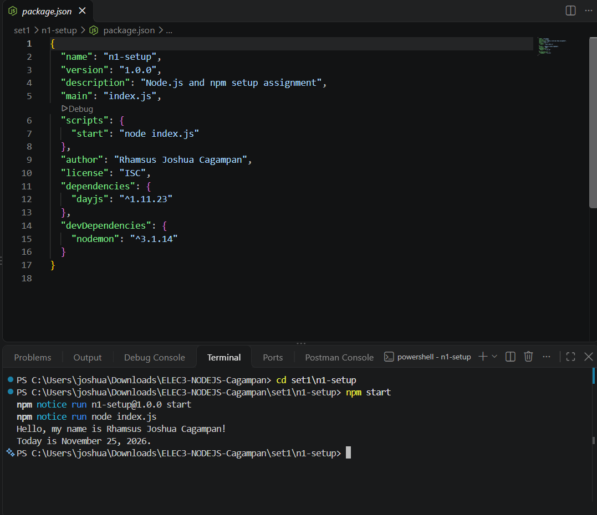
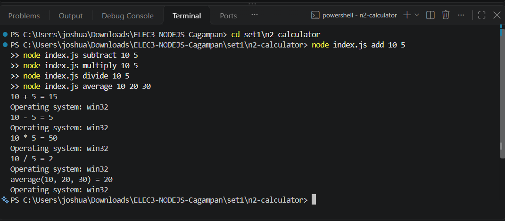
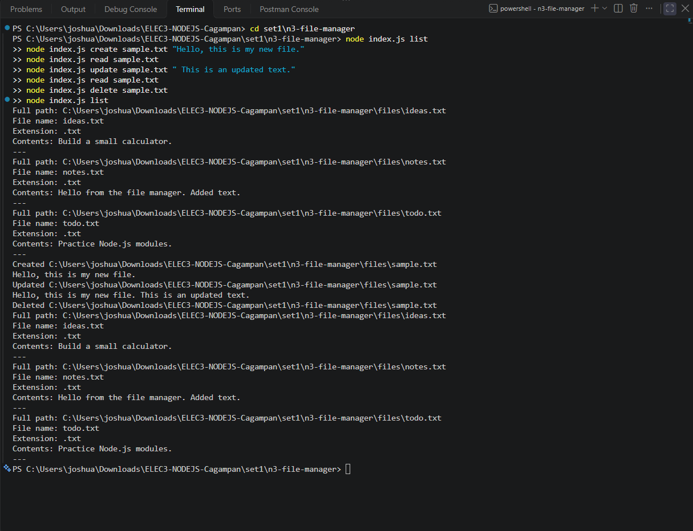

# ELEC 3 - Node.js

Name: Rhamsus Joshua Cagampan  
Section: IV-BSIT C  
Course: ELEC 3 - Node.js

## Activities

| Activity | Description | Folder |
| --- | --- | --- |
| N1 | Project setup with npm, `package.json`, and the `dayjs` and `nodemon` packages | [set1/n1-setup](set1/n1-setup) |
| N2 | Modular calculator using custom modules and `process.argv` | [set1/n2-calculator](set1/n2-calculator) |
| N3 | File manager using the `fs` and `path` modules | [set1/n3-file-manager](set1/n3-file-manager) |

## How to Run

Make sure Node.js and npm are installed.

### N1 - Project Setup

```bash
cd set1/n1-setup
npm install
npm start
```

Prints a greeting and today's date formatted with `dayjs`.

### N2 - Modular Calculator

```bash
cd set1/n2-calculator
node index.js add 12 8
node index.js divide 5 0
```

Supported operations: `add`, `subtract`, `multiply`, `divide`, and `average`.

- `add`, `subtract`, `multiply`, and `divide` require exactly two numbers.
- `average` accepts one or more numbers, for example `node index.js average 10 20 30`.
- Invalid input and division by zero print an error message.

Files: `index.js` (CLI), `operations.js` (math functions), and `formatter.js` (output formatting).

### N3 - File Manager

```bash
cd set1/n3-file-manager
node index.js create notes.txt "Hello"
node index.js read notes.txt
node index.js update notes.txt "More text"
node index.js delete notes.txt
node index.js list
```

All files are stored in the `files/` folder. Use file names only; folder paths are not allowed. `create` fails if the file already exists, `update` appends text, and `list` displays each file's full path, name, extension, and contents.

## Screenshots

### N1



### N2



### N3


